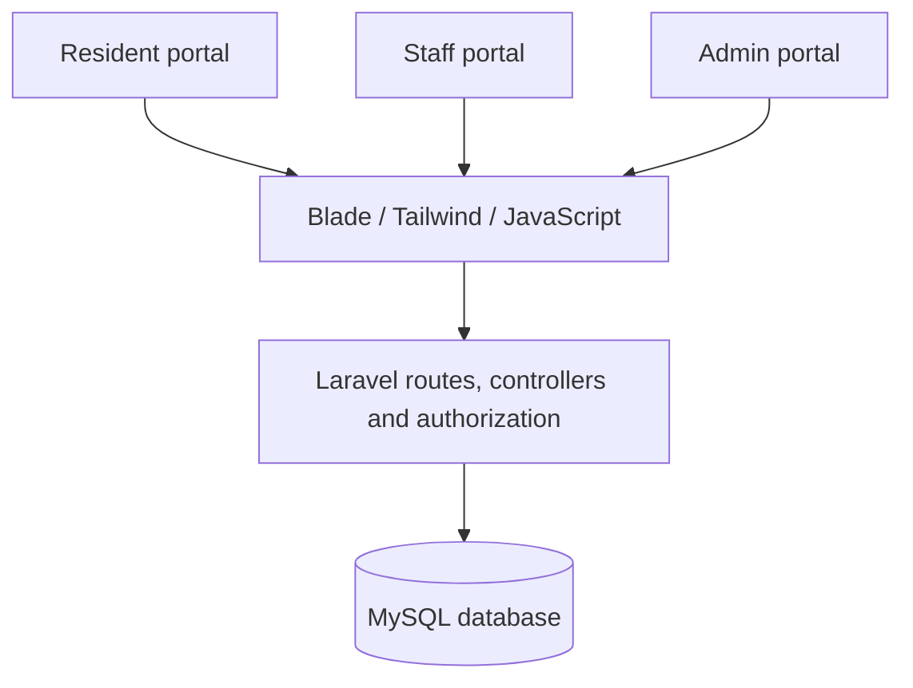

# BaryoHub

**Barangay Information and Resident Services Management System**

BaryoHub is a web-based capstone project at the University of Cebu – Lapu-Lapu and Mandaue (UCLM). It aims to simplify barangay transactions in Cebu City by connecting residents, barangay staff, and administrators through a centralized digital portal.

> **Project status:** Under development / pre-release. The upgraded application is on the [`feature/capstone-completion`](https://github.com/uclm-school-JD/baryohub/tree/feature/capstone-completion) branch. Features listed below are implemented in source code; full runtime testing, manual QA, and successful live deployment have not yet been verified.

## Objectives

- Provide residents with convenient access to barangay services and document requests.
- Improve request tracking, account approval, and communication.
- Centralize resident records, barangay officials, and incident reports.
- Support administrative decision-making through statistics and downloadable reports.
- Restrict administrative functions to authorized accounts.

## System features

| Module | Features implemented in source code |
| --- | --- |
| Authentication | Registration, login, email verification, password reset, and basic profile management |
| Resident services | Document requests, reference numbers, status tracking, basic personal data sheet, and notifications |
| Document processing | Barangay clearance, certificate of residency, certificate of indigency; office request queue, filtering, and status updates |
| Administration | Dashboard statistics, resident account approval, resident search, staff access management, and barangay announcements |
| Resident records | Personal information, senior citizen counts based on birth date, and admin-managed indigent classification |
| Officials | Add and update barangay officials; activate or deactivate records |
| Incident reporting | Non-emergency reports, resident tracking, administrative review, and resolution |
| Analytics | Monthly document-request statistics and CSV export |
| Resident card | Printable prototype resident record card (not an official government-issued ID) |

Document request statuses: **Pending → In progress / Approved / Rejected → Ready for pickup → Released**. These are available status options; strict transition enforcement is not yet established.

## User roles

| Role | Access |
| --- | --- |
| Resident | Complete a basic personal data sheet, track personal requests, read announcements and notifications; approved residents can submit document requests and incident reports |
| Barangay staff | Process document requests through the office queue |
| Administrator | Manage staff privileges, resident approval and classifications, officials, incidents, reports, and announcements |

New registrations receive the resident role and require administrative approval for document and incident submissions. Existing accounts retain approved status when the new migration is applied.

## Technology stack

| Layer | Technology |
| --- | --- |
| Frontend | Laravel Blade, Tailwind CSS, JavaScript, Vite |
| Backend | PHP 8.2+, Laravel 12 |
| Authentication | Laravel Breeze, Laravel authorization gates |
| Database | MySQL; SQLite in-memory for the configured test suite |
| Development | VS Code, XAMPP, Composer, Node.js, npm |
| Version control | Git and GitHub |
| Testing | PHPUnit / Laravel feature tests |
| Deployment | Railway (planned; live deployment not verified) |

**Note:** The framework is Laravel 12, as specified in `composer.json`, despite the older setup branch containing “laravel-13” in its name.

## System architecture



## Getting started (Windows / XAMPP)

### Prerequisites

Install Git, Composer, PHP 8.2 or later with the required PHP extensions (including PDO MySQL), Node.js with npm (use a Vite-compatible supported version), and MySQL. Start MySQL in XAMPP. Check that the terminal uses the intended PHP and Node installations:

```powershell
php -v
composer --version
node -v
npm.cmd -v
git --version
```

### 1. Clone the upgraded application

```powershell
cd C:\xampp\htdocs
git clone --branch feature/capstone-completion https://github.com/uclm-school-JD/baryohub.git
cd baryohub
code .
```

If the repository is already cloned, first commit or stash local work, then run:

```powershell
git fetch origin
git switch feature/capstone-completion
git pull origin feature/capstone-completion
```

### 2. Install dependencies and configure the environment

```powershell
composer install
npm.cmd ci
if (!(Test-Path .env)) { Copy-Item .env.example .env }
```

For a new installation with an empty `APP_KEY`, run `php artisan key:generate`. Do not regenerate an existing production key.

### 3. Configure MySQL

Create a database named `baryohub_laravel` in phpMyAdmin. Edit the local `.env` file:

```dotenv
APP_NAME=BaryoHub
APP_ENV=local
APP_DEBUG=true
APP_URL=http://127.0.0.1:8000

DB_CONNECTION=mysql
DB_HOST=127.0.0.1
DB_PORT=3306
DB_DATABASE=baryohub_laravel
DB_USERNAME=root
DB_PASSWORD=

MAIL_MAILER=log
```

Use your own local database credentials. Never commit the `.env` file or production secrets. Back up an existing database before migrating.

### 4. Migrate, build and run

```powershell
php artisan migrate
php artisan optimize:clear
npm.cmd run build
php artisan serve
```

Open [http://127.0.0.1:8000](http://127.0.0.1:8000). Register a test account and verify its email. With the local log mailer, verification and password-reset links are written to `storage/logs/laravel.log`; configure SMTP for actual email delivery.

### 5. Create the first administrator

Register and verify the account first. Replace the sample address with the email you registered:

```powershell
php artisan baryohub:grant-admin admin@example.test
```

Sign in and open **Admin management dashboard**. Approve a resident account before testing document and incident submissions.

## Testing and QA

```powershell
php artisan route:list
php artisan test
```

The repository includes feature tests for registration, profile, document requests, barangay announcements, and additional capstone modules (approval, access control, incident handling, printable card and CSV download). Test files are present, but passing results have not been verified.

Use fictional data to demonstrate the workflow:

1. Register, verify and complete the resident personal data sheet.
2. Sign in as administrator and approve the account.
3. Submit a document request as resident, process it as staff, and check tracking and notifications.
4. Submit a sample incident and resolve it as administrator.
5. Review resident statistics and officials; export a CSV and open it in Excel or Google Sheets.
6. Verify access control, input validation, mobile layout and all tests.

## Capstone task status

| Member / workstream | Status |
| --- | --- |
| Member 1 – Backend (Modules 6–7) | Core resident services and admin backend added; audit logs with date filtering and full staff account lifecycle remain incomplete |
| Member 2 – Frontend (Modules 6–7) | Resident and admin screens added; full PDS and dedicated admin sidebar remain incomplete; responsive QA pending |
| Member 3 – Testing | Feature tests added; full coverage and passing test execution pending |
| Member 4 – QA and documentation | Guides added; manual QA, CSV compatibility checks and live deployment verification pending |

The original IT-ELEC school-queue assignments were adapted to the BaryoHub barangay-service context. Queue-specific TV display requirements are not represented as completed features.

## Documentation

The following guides are stored on the upgraded application branch.

- [Administrator guide](https://github.com/uclm-school-JD/baryohub/blob/feature/capstone-completion/ADMIN_GUIDE.md)
- [Resident user guide](https://github.com/uclm-school-JD/baryohub/blob/feature/capstone-completion/USER_GUIDE.md)
- [Demonstration and QA checklist](https://github.com/uclm-school-JD/baryohub/blob/feature/capstone-completion/DEMO.md)
- [Deployment checklist](https://github.com/uclm-school-JD/baryohub/blob/feature/capstone-completion/CAPSTONE_DEPLOYMENT.md)

## Deployment and privacy

Railway is the intended deployment platform. Follow the deployment checklist to configure the PHP runtime, database, HTTPS, application key, SMTP, public web root, asset build and migrations. No verified public live URL is currently documented.

The system handles potentially sensitive resident information. Use fictional records for demonstrations. Before production use, establish authorized access, privacy and retention procedures, secure backups, and a security review. The incident module is not an emergency response service.

## Contribution workflow

Create a feature branch, make focused changes, run tests, and open a pull request for review. Do not commit credentials or real resident data.

```powershell
git switch feature/capstone-completion
git pull origin feature/capstone-completion
git switch -c feature/your-task
# Make and test your changes
git add .
git commit -m "Describe your change"
git push -u origin feature/your-task
```

## Project status and final deliverables

- [x] GitHub repository and upgraded application branch
- [x] Core resident and administrative source code enhancements
- [x] Basic administrator, resident, demo and deployment guides
- [x] Additional automated test files
- [ ] Remaining feature gaps and full test coverage
- [ ] Verified passing tests and manual quality assurance
- [ ] Review and merge upgraded application into the default branch
- [ ] Successful Railway deployment and verified live link
- [ ] Final manuscript and presentation slides

---

**BaryoHub | BS Information Technology Capstone Project | UCLM**
